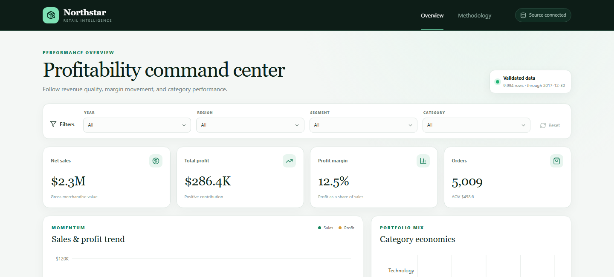
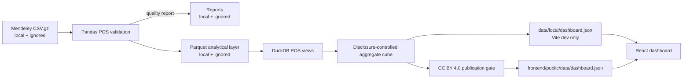

# Northstar Retail BI

Northstar is a portfolio-grade retail business intelligence and profitability platform built around a fully synthetic, openly licensed multi-store point-of-sale dataset. It validates 970,838 POS line items with Pandas, models business views with DuckDB and SQL, and serves disclosure-controlled aggregates to a responsive React dashboard.

The raw CSV archive, customer and transaction identifiers, local Parquet files, quality reports, and private development exports remain outside Git and deployment artifacts.

**Live dashboard:** [retail-bi-analytics.pages.dev](https://retail-bi-analytics.pages.dev/)



## Project objective

Build an end-to-end analytics product that converts a large, imperfectly shaped POS export into trustworthy business metrics and a decision-ready dashboard. The project demonstrates practical data validation, SQL modeling, KPI governance, interactive analysis, privacy-aware publication, automated testing, and production deployment.

## Business questions

- How are net sales, gross profit, margin, transaction volume, and average ticket changing?
- Which categories and stores contribute the most gross profit?
- How do payment method, store, category, and year selections change performance?
- How does discount depth affect payment-line margin?
- What impact do signed refunds have on net performance?

## Technology

| Layer | Tools |
| --- | --- |
| Data validation | Python 3.13, Pandas, PyArrow |
| Analytical modeling | DuckDB, SQL, Parquet |
| Dashboard | React 19, TypeScript, Vite, Tailwind CSS 4, Recharts |
| Quality | Pytest, Vitest, Testing Library, Oxlint, TypeScript |
| Delivery | GitHub Actions, Cloudflare Pages |

## Portfolio relevance

- Translates business questions into governed KPI definitions rather than relying on ambiguous source labels.
- Validates accounting identities, signs, types, dates, duplicates, and required fields before analysis.
- Uses DuckDB and SQL to create reusable analytical views from a Parquet layer.
- Delivers filter-aware KPIs and visual diagnostics for management-style exploration.
- Applies minimum-cohort and complementary-suppression controls before browser publication.
- Automates Python, frontend, lint, and production-boundary checks in CI.

See the [job-application project description](docs/portfolio-project-description.md) for concise résumé and interview-ready versions.

## Architecture



Production code reads `/data/dashboard.json`. The Vite development-only `/__local/dashboard.json` middleware never enters `dist`, and the post-build audit rejects local paths, direct identifiers, unexpected fields, small aggregates, and over-granular views.

## Validated analytical findings

The source covers 2024-01-01 through 2025-12-31 across 30 synthetic stores, six product categories, and 585,691 transactions.

| KPI | Result |
| --- | ---: |
| Net sales | $46,595,173.27 |
| Gross profit | $25,784,056.34 |
| Gross margin | 55.34% |
| Distinct transactions | 585,691 |
| Average ticket | $79.56 |
| Net refund sales | -$396,495.00 |

Selected descriptive findings:

- 2025 net sales were approximately 5.49% above 2024.
- Apparel contributed $10.26M gross profit at 57.31% margin.
- Beauty had the highest category margin at approximately 68.22%.
- Payment lines with no discount produced approximately 57.77% margin; payment lines above 20% discount produced approximately 40.10%.
- Store 09 - Chicago was the largest gross-profit contributor at approximately $1.59M.

These are deterministic results from a seeded synthetic simulation, not claims about a real company or customers.

## KPI definitions

- **Net sales:** source `Net Sales`, including signed refunds and discounts.
- **Gross profit:** source `Gross Profit` = Net Sales - Unit Cost x Qty.
- **Gross margin:** Gross Profit / Net Sales.
- **Transactions:** distinct `Transaction ID`, including separately identified refund transactions.
- **Average ticket:** Net Sales / distinct transactions.
- **Discount bands:** effective payment-line discount amount divided by gross sales; refund rows are excluded from this diagnostic but remain included in net KPIs.

Filters use the actual source dimensions: year, store location, payment method, and category. No region, customer segment, shipping field, or order status is synthesized.

## Data quality and privacy

The pipeline validates required fields, dates, numeric types, payment/refund signs, discount signs, duplicate rows, and four line-level accounting identities. The current source has zero exact duplicate rows and zero accounting-identity failures.

The browser export contains only KPI, monthly, category, store, and discount-band aggregates. It excludes Customer ID, Transaction ID, Item, SKU, Price Point Name, Device Name, time-of-day, and all line-level records. It allows at most three simultaneous filters, requires at least 10 transactions per published aggregate, and uses complementary suppression for a single small child cell.

## Dataset attribution and license

Source: [A Synthetic Multi-Store Retail Point-of-Sale Transaction Dataset in Square POS Export Format](https://data.mendeley.com/datasets/39xdjxgnmf/1), MD Owes Quruny Shubho, Mendeley Data, Version 1, DOI [10.17632/39xdjxgnmf.1](https://doi.org/10.17632/39xdjxgnmf.1).

Licensed under [Creative Commons Attribution 4.0 International](https://creativecommons.org/licenses/by/4.0/). Northstar adapts the source into validated Parquet data, SQL analytical views, and aggregate browser JSON. The source is fully synthetic and is not affiliated with or endorsed by Square or Block, Inc.

See [dataset provenance](docs/data-provenance.md), [methodology](docs/methodology.md), and [data quality review](docs/data-quality-review.md).

## Run locally

Requirements:

- Python 3.13
- Node.js 22+
- `data/raw/mendeley_pos/01_square_item_sales_detail_24mo.csv.gz`

```powershell
.\.venv\Scripts\python.exe -m pip install -r requirements.txt
.\.venv\Scripts\python.exe -m retail_bi.pos_pipeline --local-export

cd frontend
npm ci
npm run dev
```

Open <http://127.0.0.1:5173/>. The raw, processed, report, and local export files are Git-ignored.

## Tests and release checks

```powershell
.\.venv\Scripts\python.exe -m pytest
cd frontend
npm run lint
npm test
npm run build
```

To create the proposed licensed production asset for review:

```powershell
.\.venv\Scripts\python.exe -m retail_bi.pos_pipeline --publish-export
```

The command verifies `data/source_manifest.json` before writing `frontend/public/data/dashboard.json`. No push or deployment should occur until the generated asset and production build have been reviewed.

## Cloudflare Pages

| Setting | Value |
| --- | --- |
| Live URL | [retail-bi-analytics.pages.dev](https://retail-bi-analytics.pages.dev/) |
| Cloudflare project | `retail-bi-analytics` |
| Framework preset | React (Vite) |
| Production branch | `main` |
| Root directory | `frontend` |
| Build command | `npm run build` |
| Build output directory | `dist` |
| Node.js | 22 or newer |

`frontend/wrangler.toml` matches the Pages root configuration. Cloudflare Pages automatically deploys reviewed commits from `main`; the live release has been checked against the committed aggregate asset and production bundle.

## Repository guide

```text
retail_bi/pos_*.py             Synthetic POS validation, modeling, and pipeline
sql/pos_analysis.sql           POS business views
tests/test_pos_*.py            POS validation and analytical tests
retail_bi/{schema,validation,analytics,pipeline}.py
                               Preserved legacy implementation
frontend/src/                  React dashboard and tests
frontend/scripts/              Production boundary and privacy audit
docs/                          Architecture, methodology, provenance, and quality
data/source_manifest.json      Versioned source, checksum, attribution, and CC BY evidence
```

## Known limitations

- The source is synthetic and intentionally reflects its seeded generation assumptions.
- Refunds are separate negative transactions rather than links to original baskets.
- A flat 8.25% tax and simplified CST label are applied to all stores.
- Customer identifiers are nominal and excluded from all browser exports.
- The catalog and prices are static across the two-year period.
- The dashboard is descriptive; it does not infer causality or represent a real operating business.

## Code license

No software license has been selected yet. Until one is added, the source code remains under default copyright terms. The dataset is licensed separately under CC BY 4.0.
