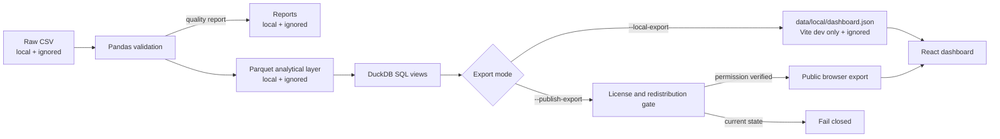

# Northstar Retail BI

Northstar is a portfolio-grade retail business intelligence and profitability analytics platform. It validates a Superstore transaction dataset with Pandas, models reusable business views in DuckDB SQL, and presents filter-aware KPIs and diagnostics in a responsive React dashboard.

The repository publishes the application, analytics code, tests, and methodology—not the source dataset or generated browser data. The current dataset's redistribution permission has not been established, so public data export remains disabled by design.


> Screenshot from the private local-data preview. Its generated JSON is Git-ignored and cannot enter a production build.

## What the dashboard answers

- How are revenue, profit, margin, order volume, and average order value changing?
- Which categories and regions contribute the most profit?
- Where do discounts stop supporting profitable growth?
- How do year, region, segment, and category selections change every applicable KPI and visualization?

## Technology

| Layer | Tools |
| --- | --- |
| Data validation | Python 3.13, Pandas, PyArrow |
| Analytical modeling | DuckDB, SQL, Parquet |
| Dashboard | React 19, TypeScript, Vite, Tailwind CSS 4, Recharts |
| Quality | Pytest, Vitest, Testing Library, Oxlint, TypeScript |
| Delivery | GitHub Actions, Cloudflare Pages |

## Architecture



The Vite development server exposes the local export through `/__local/dashboard.json`. That middleware is registered only for `vite serve`. Production builds read only `/data/dashboard.json`, and a post-build safety check fails if the local path or endpoint appears in `dist`.

## Validated analytical findings

The local pipeline validated 9,994 rows covering 2014-01-03 through 2017-12-30.

| KPI | Result |
| --- | ---: |
| Revenue | $2,297,200.86 |
| Profit | $286,397.02 |
| Profit margin | 12.47% |
| Distinct orders | 5,009 |
| Average order value | $458.61 |

Selected diagnostic findings:

- Technology generated $145,454.95 profit at approximately 17.4% margin.
- Office Supplies generated $122,490.80 profit at approximately 17.0% margin.
- Furniture produced only $18,451.27 profit at approximately 2.5% margin.
- Orders without a discount produced approximately 29.5% margin.
- Discounts of 21–40% produced a -15.3% margin; discounts above 40% produced a -77.4% margin.
- West was the largest regional profit contributor at $108,418.45.

These values are descriptive results from the specified dataset, not claims about a real operating company. See [methodology](docs/methodology.md) and [data quality review](docs/data-quality-review.md).

## Analytical methodology

1. Normalize conventional Superstore headers to stable snake-case fields.
2. Validate required columns, nulls, identifiers, dates, numeric types, shipping chronology, quantity, sales, and discount bounds.
3. Preserve the validated source rows in a local Parquet analytical layer.
4. Create DuckDB views for KPI summary, monthly performance, category and state performance, discount effectiveness, and loss drivers.
5. Export only the dimensions and measures required by the dashboard.
6. Recalculate KPIs, monthly trends, category performance, regional profit, and discount bands in the browser for the active filter context.

The quality review identified one possible duplicate: rows 3406 and 3407 are identical except for their unique `Row ID`. Both remain preserved because no authoritative correction or documented order-line key establishes that one should be removed.

## Run locally

### Requirements

- Python 3.13
- Node.js 22+
- The source CSV at `data/raw/Sample - Superstore.csv`

### Install and validate

```powershell
py -3.13 -m venv .venv
.\.venv\Scripts\python.exe -m pip install -r requirements.txt
cd frontend
npm ci
cd ..
.\.venv\Scripts\python.exe -m pytest
```

### Generate the private preview

```powershell
.\.venv\Scripts\python.exe -m retail_bi.pipeline `
  --source "data/raw/Sample - Superstore.csv" `
  --local-export

cd frontend
npm run dev
```

Open <http://127.0.0.1:5173/>. The generated `data/local/dashboard.json` stays outside `frontend/public` and is ignored by Git.

## Tests and release checks

```powershell
.\.venv\Scripts\python.exe -m pytest
cd frontend
npm run lint
npm test
npm run build
```

`npm run build` performs TypeScript compilation, creates the optimized Vite bundle, and verifies that neither `data/local/dashboard.json` nor `/__local/dashboard.json` leaked into the output.

GitHub Actions repeats the Python and frontend checks on pull requests and pushes to `main`.

## Cloudflare Pages

Use the following Git integration settings:

| Setting | Value |
| --- | --- |
| Framework preset | React (Vite) |
| Root directory | `frontend` |
| Build command | `npm run build` |
| Build output directory | `dist` |
| Node.js | 22 or newer |

[`frontend/wrangler.toml`](frontend/wrangler.toml) uses `pages_build_output_dir = "./dist"`, matching the configured Pages root. The root [`wrangler.toml`](wrangler.toml) is retained for direct-upload commands run from the repository root.

The current production build intentionally contains no dataset-derived browser JSON and will show the transparent data-unavailable state. A data-backed public deployment remains blocked until redistribution permission is established.

## Data provenance and licensing

The dataset was downloaded from the [Kaggle Superstore listing](https://www.kaggle.com/datasets/vivek468/superstore-dataset-final). Kaggle labels it “Other (specified in description),” and the uploader does not provide an explicit redistribution grant. Public availability is not treated as permission.

The publication pipeline requires all of the following before creating a public browser export:

- `license_verified: true`;
- `redistribution_status: permitted`; and
- an authoritative HTTPS permission URL.

The committed manifest deliberately remains closed. See the full [provenance decision](docs/data-provenance.md). Do not commit anything under `data/raw`, `data/processed`, `data/reports`, `data/local`, or `frontend/public/data`.

## Known limitations

- Profit is accepted from the source and cannot be independently reconstructed without cost data.
- Returns are not modeled unless a future licensed source documents them.
- Currency is displayed as USD based on the dataset context.
- The duplicate candidate is retained, so affected totals reflect both source rows.
- Browser-side filtering is appropriate for this portfolio-scale dataset, not sensitive or high-volume production data.
- Public deployment is currently code-only because dataset redistribution permission is unresolved.

## Repository guide

```text
retail_bi/                 Python validation, licensing, pipeline, and export logic
sql/analysis.sql           DuckDB business views
tests/                     Python tests
frontend/src/              React dashboard and frontend tests
frontend/scripts/          Production-boundary release check
.github/workflows/ci.yml   Continuous integration
docs/                      Architecture, methodology, provenance, and quality notes
data/source_manifest.json  Closed publication decision; no dataset content
```

## Code license

No software license has been selected yet. Until the repository owner adds one, the source code remains under default copyright terms. The dataset is governed separately and is not included in this repository.
